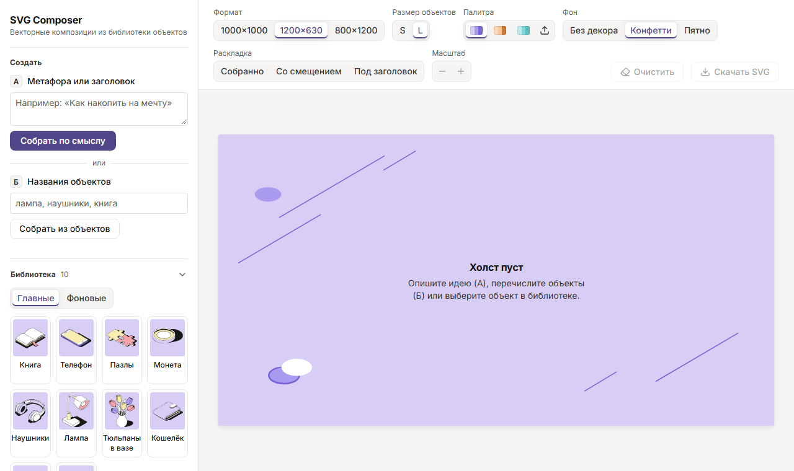

# SVG Composer

Веб-сервис собирает векторные иллюстрации из готовых объектов библиотеки Figma и
экспортирует их в SVG. Новых объектов он не генерирует: каждый объект копируется
как есть, без перерисовки.

**Демо:** https://svg-composer.svg-composer.workers.dev
**Репозиторий:** https://github.com/Dannke/svg-composer



*Анимация (20 с) записана `npm run demo` на живом сервисе: сценарий А через LLM → 800×1200 →
«Со смещением» → сценарий Б («лампу, нушники…») → размер S → персиковая и бирюзовая схемы →
поворот ручкой на холсте → загрузка своей палитры из JSON.*

## Что умеет

- **Сценарий А — метафора или заголовок.** LLM (OpenRouter, бесплатные модели `:free`)
  на сервере подбирает 2–5 главных объектов, при необходимости один фоновый и пресет.
  Если LLM недоступна, сервис ищет объекты по смысловым тегам.
- **Сценарий Б — названия объектов.** Понимает синонимы («смартфон», «букет»), словоформы
  («лампу», «наушниками») и опечатки («нушники»). Слово «фон», «фоновый», «фоновые» делает
  следующий объект фоновым: «наушники, фоновые тюльпаны».
- **Главные и фоновые объекты.** Главные — цветные, фоновые — монохромные (только цвета фона
  схемы), оба вида из библиотеки Figma. Фоновые стоят позади главных, как в «Примерах
  композиций» ТЗ; в библиотеке есть переключатель «Главные / Фоновые».
- **Редактор холста.** Можно добавлять, перемещать (drag), поворачивать (ручкой над рамкой,
  с Shift — шагом 15°, или ползунком), дублировать и удалять объекты, менять порядок слоёв,
  переключать вид объекта (главный цветной / фоновый монохромный), масштабировать всю композицию.
- **Размер S/L.** При переключении подгружаются элементы другого размера: в Figma они
  отличаются детализацией.
- **Цветовые схемы** (сиреневая, персиковая, бирюзовая) перекрашивают и объекты, и фон.
- **Своя палитра.** Кнопка загрузки рядом со схемами принимает JSON
  ([пример](public/palette-example.json)): 3 цвета фона и 3 цвета объектов. Сервис проверяет
  формат и правило библиотеки «цвета объектов нельзя использовать в фонах», сразу перекрашивает
  композицию и запоминает палитру в браузере.
- **Форматы:** 1000×1000, 1200×630, 800×1200.
- **Пресеты раскладки:** «Собранно», «Со смещением», «Под заголовок». Объекты собираются
  в плотный кластер по изометрическим осям, как в эталонах Figma. Форма кластера подстраивается
  под формат, порядок слоёв идёт по глубине сцены.
- **Декоративный фон:** «Конфетти» или «Пятно» — линии, конфетти и пятно из Figma, в цветах
  фона текущей схемы, своя расстановка для каждого формата; можно выключить («Без декора»).
- **«Очистить»** убирает все объекты; пока холст пуст, его можно вернуть кнопкой «Вернуть».
- **Экспорт в SVG.** Файл векторный и редактируемый: каждый объект — отдельная группа
  `<g id="lamp">` с исходными путями, растра и `<image>` нет.

## Запуск

```bash
npm install
cp .env.example .env    # OPENROUTER_API_KEY — по желанию, без него работает запасной режим
npm run dev             # http://localhost:5173
```

| Команда | Что делает |
|---|---|
| `npm run build` | проверка типов + сборка в `dist/` |
| `npm test` | юнит-тесты (Vitest) |
| `npm run e2e` | Playwright: оба сценария, S/L, все схемы, пресеты, экспорт (`npx playwright install chromium` один раз) |
| `npm run preview` | собранная версия с тем же `/api/compose` |
| `npm run deploy` | сборка и деплой на Cloudflare Workers (`wrangler login`, ключ: `wrangler secret put OPENROUTER_API_KEY`) |
| `npm run figma:fetch` | выгрузка 40 SVG из Figma (нужен `FIGMA_TOKEN`) |
| `npm run figma:fetch-decor` | выгрузка 6 кадров декоративных фонов из Figma (нужен `FIGMA_TOKEN`) |
| `npm run assets` | `figma-raw/` → `assets/objects/` + `src/data/manifest.json` + силуэты `src/data/masks.json` |
| `npm run demo` | записать `docs/demo.png` (анимированный PNG) на живом сервисе; адрес можно передать: `npm run demo -- http://localhost:5173` |
| `npx vite-node scripts/bench-llm.ts -- <модели>` | замер скорости и валидности бесплатных моделей на запросе сервиса |
| `npm run examples` | пересобрать `/examples` |

## Архитектура

```
Figma ──figma:fetch──▶ figma-raw/*.svg ──assets──▶ assets/objects/*.svg + manifest.json
                                                          │
schemes.json (палитры, роли) ─────────────────────────────┤
                                                          ▼
     src/core: catalog · layout · match · palette · render (общий код клиента и сервера)
             │                                   │
     React-редактор (src/App.tsx)        worker/index.ts → src/server/compose.ts → OpenRouter
```

**Хранение.** Каждый вариант объекта (10 объектов × главный/фоновый × S/L = 40) лежит
в отдельном файле `assets/objects/<slug>-<size>-<kind>.svg`, например `lamp-L-main.svg`.
Декоративные фоны — `assets/decor/decor-<стиль>-<формат>.svg` (2 стиля × 3 формата). Это кадры
страницы «Примеры композиций», выгруженные целиком (`npm run figma:fetch-decor`); при сборке
группы объектов из них вырезаются, а сборка падает, если в декоре остался цвет не из фона.
`src/data/manifest.json` — каталог: id, русское имя, slug, вид, размер, узел Figma, bbox,
роли цветов, синонимы и теги. Палитры хранятся данными в `src/data/schemes.json`:
у схемы 3 своих цвета фона и 3 цвета объектов, а чёрный и белый общие для всех (`neutrals`).
Чтобы добавить схему, достаточно новой записи из 6 цветов, код менять не нужно. Ту же запись
можно загрузить и в работающий сервис кнопкой «Загрузить палитру» (`src/core/palette.ts`: проверка,
добавление, акцент интерфейса). `src/data/masks.json` — силуэт каждого из 40 SVG сеткой
до 20 клеток по длинной стороне. Его растеризует Chromium из Playwright при сборке данных
(`scripts/build-masks.mjs`), а раскладка прикладывает объекты по силуэтам.

**Извлечение.** `scripts/fetch-figma.mjs` одним запросом к Figma REST API (`/v1/images`,
`format=svg`) выгружает узлы из `scripts/figma-nodes.json`. Скрытые слои Figma при этом
не рендерит. Затем `scripts/normalize-svg.mjs`:
- заменяет корневой `<svg>`, приводит цвета к `#rrggbb`;
- удаляет id-имена слоёв, а ссылочные id (clipPath, mask) помечает плейсхолдером
  `__ID__`, чтобы при вставке объекта дать им уникальный префикс;
- считает, какие цвета палитры в каком объекте используются (`colorRoles`).

Геометрия и порядок путей не меняются.

**Переиспользование.** Все SVG бандлятся в приложение строками. Объект на холсте —
это `<g transform="translate(cx cy) rotate(r) scale(k) translate(-w/2 -h/2)">` с телом
исходного файла внутри. Перекраска работает как подстановка по ролям: цвет схемы-источника
(в Figma объекты нарисованы в сиреневой) → роль (`bg1…bg3`, `ink`, `obj1…obj3`, `white`)
→ цвет выбранной схемы. Холст и экспорт строятся одними функциями (`itemTransform`,
`itemMarkup`, `renderSvg`), поэтому скачанный файл совпадает с тем, что на экране.

**Раскладка** (`src/core/layout.ts`) — чистые функции, в исходных единицах Figma и с одним
общим масштабом:
- **упаковка кластером.** Крупные объекты ставятся первыми, каждый следующий прикладывается
  к одному из уже стоящих по изометрической оси (наклон 1:2, как у самих объектов и их
  расстановки в «Примерах композиций»), по диагонали 45° или по горизонтали. Строго вертикально
  объекты не ставятся, иначе один «висит» над другим. Из всех мест выбирается то, при котором
  кластер впишется в формат крупнее всего, при равенстве — ближе к центру, а мелкий объект
  охотнее встаёт перед крупным. Поэтому у 1200×630 кластер вытягивается вширь, у 800×1200 —
  ввысь. Жадный выбор зависит от первого объекта, поэтому первыми по очереди пробуются три
  крупнейших (8 объектов раскладываются за ~16 мс);
- **по силуэтам, а не по рамкам.** У изометрических объектов углы рамки пустые: монета
  может лечь в угол рамки кошелька, ручка — под абажур лампы. Близость считается по маскам
  `masks.json`: какую долю меньшего силуэта закрывает пересечение;
- «Собранно» — сосед налегает на соседа на 8 % силуэта (в эталоне SVG-drop объекты слегка
  заходят друг на друга), с остальными — не больше 4 %;
- «Со смещением» — от касания ещё 15 % расстояния, ни с кем не пересекаться; зеркально, как
  в эталонных кадрах «SVG-drop». Отражаются силуэты при упаковке и расстановка, сами объекты — нет;
- **порядок слоёв — по глубине сцены**: чем ниже нижний край силуэта, тем ближе объект
  к зрителю и тем выше его слой;
- укладка по эталону: телефон кладётся на книгу, пазлы — на телефон, а без телефона — на книгу,
  в том числе на фоновую (`src/data/stacking.json`). Основание и всё, что на нём лежит,
  пакуются одним блоком; если основания в наборе нет, объект встаёт в кластер сам;
- фоновые объекты в кластер не входят: слоем позади, центр выше верхнего края главных
  на 0,4 своей высоты и сдвинут вбок на 0,4 ширины группы (первый влево, второй вправо).
  При вписывании в холст учитывается только нижняя половина фонового объекта, верхняя может
  уйти за край кадра, как в Figma. Если главных нет, фоновые пакуются как обычные;
- «Под заголовок» — раскладка «Собранно», уменьшенная одним коэффициентом и сдвинутая
  в свободную от текста зону: вправо у горизонтального формата, вниз у остальных.

Тесты проверяют: расстояния в «Под заголовок» меняются ровно в `k` раз; порядок слоёв идёт
по глубине; форма кластера следует формату; композиция занимает кадр по одной из осей;
в «Собранно» каждый объект виден не меньше чем на 75 %, в «Со смещением» объекты не перекрываются.

**LLM** (`src/server/compose.ts`) вызывается только с сервера: в Cloudflare Worker или
в middleware Vite локально. Ключ берётся из переменной окружения. Порядок работы:
- модели из списка (`OPENROUTER_MODELS` или список по умолчанию) запускаются по очереди:
  следующая подключается сразу, если предыдущая ответила ошибкой, или через 2 с, если
  она молчит. Побеждает первый валидный ответ, остальные запросы отменяются. Общий
  потолок ожидания — 5 с, дальше сразу запасной режим. Обычно тратится один вызов
  на запрос: у бесплатного ключа OpenRouter всего 50 запросов к `:free` моделям в сутки;
- запрос без «размышлений» модели (`reasoning: { enabled: false }`, `max_tokens: 200`):
  для выбора 2–5 id они не нужны, а добавляют секунды. По замерам (`scripts/bench-llm.ts`)
  Nemotron отвечает за 0,7–1,2 с вместо 2,5–8 с с размышлениями;
- ответ должен быть строгим JSON; принимаются только id из каталога, без повторов;
- если ни одна модель не дала валидного ответа, объекты ищутся по синонимам и смысловым
  тегам (`scripts/search-meta.json`);
- успешные ответы кэшируются в памяти;
- не больше 6 запросов в минуту с одного адреса. Счёт ведёт Durable Object `ComposeLimiter`,
  один на адрес (`worker/index.ts`). Сверх лимита сервис не отвечает ошибкой, а подбирает
  объекты по ключевым словам, и интерфейс называет причину. Такой ответ не кэшируется,
  а в заголовке ответа стоит `x-compose-limit: limited`.

## Допущения

1. **Пропорции.** Отдельный объект масштабировать нельзя: у композиции один общий
   коэффициент, кнопки «−/+» меняют только его. Объекты сохраняют взаимные размеры
   из библиотеки Figma. В эталонных кадрах «SVG-drop» объекты масштабированы
   по-разному, но мы следуем правилу ТЗ.
2. **S/L.** S-элементы в Figma нарисованы в масштабе ≈1:2 к L (у 8 объектов из 10 L/S = 2,0).
   При переключении размера общий масштаб умножается или делится на 2, центры объектов
   остаются на месте, меняется детализация. Исключения из Figma: у монеты L/S = 1,87,
   у тюльпанов 1,82, поэтому в S они на 7–10 % крупнее относительно соседей. Подгонять
   их отдельным коэффициентом нельзя: масштаб у композиции один (п. 1), а взаимные
   размеры внутри S берутся из Figma как есть (проверяется тестом).
3. **Фон холста** — цвет `bg1` схемы, поверх него по желанию декор. Декор взят из кадров
   «Примеров композиций» (21:2), где он уже разложен под каждый формат: конфетти — 24:3312,
   24:7656, 24:9802; пятно — 24:2654, 24:8002, 24:9813. Квадратные фоны из библиотеки (21:25258
   и др.) не годятся для 1200×630 и 800×1200. Стиль не привязан к схеме: в библиотеке
   конфетти у сиреневой и бирюзовой, пятно у персиковой, но в примерах оба стиля встречаются
   в сиреневой. По умолчанию — конфетти. В декоре есть белый (кружок конфетти), как в самих
   фонах Figma и в примерах композиций ТЗ: белый одинаков во всех схемах (см. п. 4).
4. **Чёрный и белый.** `#181817` стоит в колонке «Цвета фона», `#ffffff` — в колонке
   «Цвета объектов». Во всех схемах они одинаковые, поэтому вынесены в общий блок
   `neutrals`, а при перекраске не меняются.
   Правило «цвета объектов не в фонах» соблюдено для цветов схемы: фон холста — только `bg1`,
   в декоре — цвета фона и общий белый (исключение по эталону ТЗ, п. 3), фоновые
   (монохромные) объекты — только цвета фона (проверяется тестами).
5. **Безымянные группы** в Figma («Group 2136136344» и др.) опознаны по месту в секции
   и размеру (S = L/2): тюльпаны в вазе, S-книга, S-папка, S-ручка. Сопоставление
   записано в `scripts/figma-nodes.json`.
6. **Отдельный вектор 17×24** рядом с L-книгой (21:29952 / 24:6272) лежит вне группы
   «Книга». В эталонные кадры он тоже не входит, поэтому не экспортируется.
7. **Округление при экспорте.** Figma REST при экспорте округляет габариты узла
   до целого пикселя (например, 544,163 → 545), то есть объект масштабируется
   не более чем на ~0,2%. Пути при этом не меняются.
8. **Запасной режим.** Если по тегам ничего не нашлось, показывается базовый набор
   (книга, лампа, наушники), и интерфейс об этом сообщает.
9. **Анимации только на экране.** Появление, удаление и переезд объектов анимируют
   внутренние обёртки внутри `<g data-uid>`; экспорт строится из состояния через
   `renderSvg` и не содержит ни классов, ни стилей анимации (снимок в
   `tests/__snapshots__/export.svg`). При смене пресета или формата объекты сохраняют
   uid и переезжают; при новой сборке — исчезают старые и появляются новые. При
   `prefers-reduced-motion: reduce` анимаций нет. Дизайн-решения — в `DESIGN.md`.
10. **Укладка объектов друг на друга.** Делается только для пар, показанных в эталоне
    «SVG-drop · Собранно · L» (275:635): телефон на книге и пазлы на телефоне. Точка укладки
    измерена по рамкам этого кадра, в долях размера нижнего объекта. Для S отдельного
    эталона нет: берутся те же доли, раз S нарисованы в масштабе 1:2 к L. В кадре
    «Со смещением» телефон лежит чуть правее, но для единообразия во всех пресетах
    используется точка из «Собранно». Пазлы на книге — среднее по трём кадрам «Примеров
    композиций» с фоновой книгой (24:2914, 24:8248, 24:9848). Другие сочетания (монета
    на кошельке и т. п.) не укладываются: в Figma для них нет данных.
11. **Фоновые объекты в композиции.** Правило взято из «Примеров композиций» (страница 21:2):
    во всех кадрах с фоновыми объектами он один и лежит позади и сверху, обрезан верхним краем
    кадра, а главные стоят перед ним. Коэффициенты 0,4 — среднее по этим кадрам. Фоновый
    объект ни на что не кладётся, но сам может быть основанием (пазлы на фоновой книге).
    В примерах Figma объекты стоят в масштабе 1:1 и сильно обрезаны кадром. Наши пресеты,
    как в кадрах «SVG-drop», вписывают главные объекты целиком. LLM предлагает 0–1 фоновый
    объект. В запасном режиме при 3+ совпадениях фоновым становится самый крупный из них,
    кроме лучшего совпадения: в примерах фоновыми стоят крупные тюльпаны, лампа, книга.
12. **Силуэты для раскладки** — это растр самих SVG из Figma вместе с их тенями: тень входит
    в объект, поэтому соседи на неё не наезжают сильнее допуска. Маски нужны только для
    расстановки, в экспорт они не попадают; объекты копируются как есть. Главные объекты
    вписываются в кадр целиком, как в «SVG-drop» (п. 11), с полем 6 %.
13. **Своя палитра** задаётся теми же 6 ролями, что встроенные (`bg1–bg3`, `obj1–obj3`). Чёрный
    и белый общие для всех схем (п. 4), поэтому в файле их нет. Палитра отклоняется, если цвет
    объекта (включая общий белый) совпадает с цветом фона (включая общий чёрный): это правило
    «цвета объектов не могут использоваться в фонах». Встроенные схемы не перезаписываются.
    Если `bg3` палитры не даёт контраст WCAG AA для кнопок и рамки выделения, интерфейс берёт
    акцент сиреневой схемы, а холст остаётся в цветах палитры. Цвета в
    `public/palette-example.json` — пример пользовательского файла, а не схема из Figma.
14. **Лимит LLM** защищает суточную квоту бесплатных моделей от одного адреса, а не от
    распределённой нагрузки. Почему Durable Object: проверка на проде показала, что запросы
    Worker попадают в разные изоляты (7 изолятов на 8 запросов), поэтому счётчик в памяти
    не работает. Привязка Workers Rate Limiting считает приблизительно и пропустила 50 запросов
    при лимите 6. Окно хранится в памяти объекта; если объект выгрузят после простоя, счёт
    начнётся заново, и для минутного окна это не важно.

## AI-инструменты

- **Claude Code (Claude Opus 5.5)** — анализ ТЗ, код, тесты, деплой.
- **Figma MCP** — чтение страниц ТЗ, структуры библиотеки, палитр и эталонных кадров.
  После исчерпания лимита тарифа Starter выгрузка SVG шла через Figma REST API.
- **OpenRouter** (бесплатные модели Nemotron, Dots и Gemma) — подбор объектов под метафору
  в самом сервисе.
- **Playwright** — e2e-проверка в браузере, растеризация силуэтов объектов (`build-masks.mjs`)
  и запись демонстрации (`record-demo.mjs`).

## Процесс работы с AI

1. Claude Code через Figma MCP прочитал страницу «Задание», правила библиотеки,
   палитры и шесть эталонных кадров «SVG-drop». Из этого получились `schemes.json`
   и `figma-nodes.json`. Оказалось, что объекты нарисованы в сиреневой схеме,
   поэтому перекраска сводится к замене цвета по роли.
2. В эталонных кадрах «Под заголовок» = «Собранно» × 0,575 со сдвигом,
   а «Со смещением» — зеркальная раскладка. Так и реализованы пресеты.
3. MCP упёрся в лимит тарифа. Вместо ручного экспорта 40 файлов написан
   `fetch-figma.mjs`: один запрос к REST API по токену из `.env`.
4. Логика (раскладка, разбор названий, валидация LLM, рендер) — чистые функции
   с юнит-тестами. UI проверен Playwright-сценариями и скриншотами пресетов,
   которые сверялись с эталоном.
5. Список бесплатных моделей OpenRouter собран из живого `/api/v1/models`, а модели
   протестированы на латентность. Их доступность меняется от запроса к запросу
   (429/503/403, таймауты). Сначала был последовательный перебор (долго), потом
   параллельный опрос (быстро, но 4 вызова из суточного лимита 50 на каждый запрос).
   Итог — ступенчатый запуск: новая модель подключается только при ошибке
   или долгом молчании предыдущей.
6. Замер `scripts/bench-llm.ts` на реальном запросе сервиса показал главное: задержку давали
   «размышления» моделей. Без них Nemotron Lightning / Super-VL / Nano-Omni отвечают
   за 0,7–1,2 с, и все ответы валидны. Dots — за 2–2,7 с. Gemma часто отдаёт 429, а Flint и LFM
   без размышлений не работают. Отсюда порядок моделей, ожидание 2 с перед следующей
   и потолок 5 с.
7. Ревью по ТЗ показало слабое место — эстетику автосборки. Раскладка рядами давала
   «полку с товарами» и пустые поля в 800×1200, тогда как в эталонах объекты плотно
   прижаты по изометрическим осям. Сначала упаковка шла по эллипсам, вписанным в рамки,
   но для лампы и ручки эллипс слишком грубый: лампа наезжала на соседей. Поэтому силуэты
   стали растром самих SVG. Каждая итерация сверялась на сетке превью (12 наборов
   × 3 формата × пресеты) с кадрами SVG-drop и «Примеров композиций». Там же нашлась
   ошибка: зеркалились позиции, а силуэты нет, отсюда наложения в «Со смещением».
   Теперь отражаются и силуэты.

## Примеры

В [`/examples`](examples/README.md) лежат три готовые композиции и запросы, по которым
они собраны.
