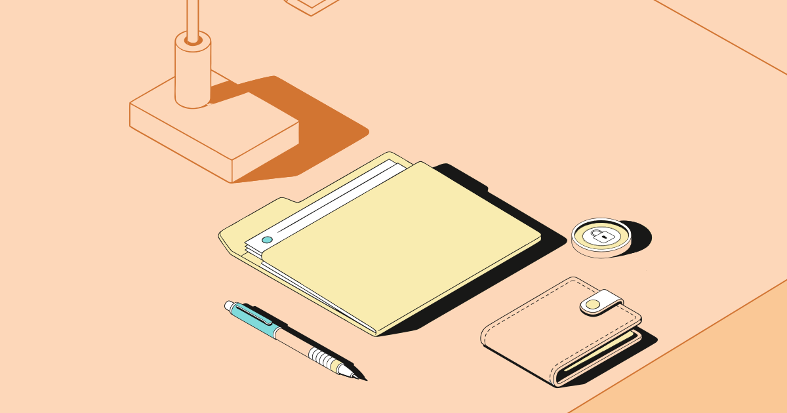
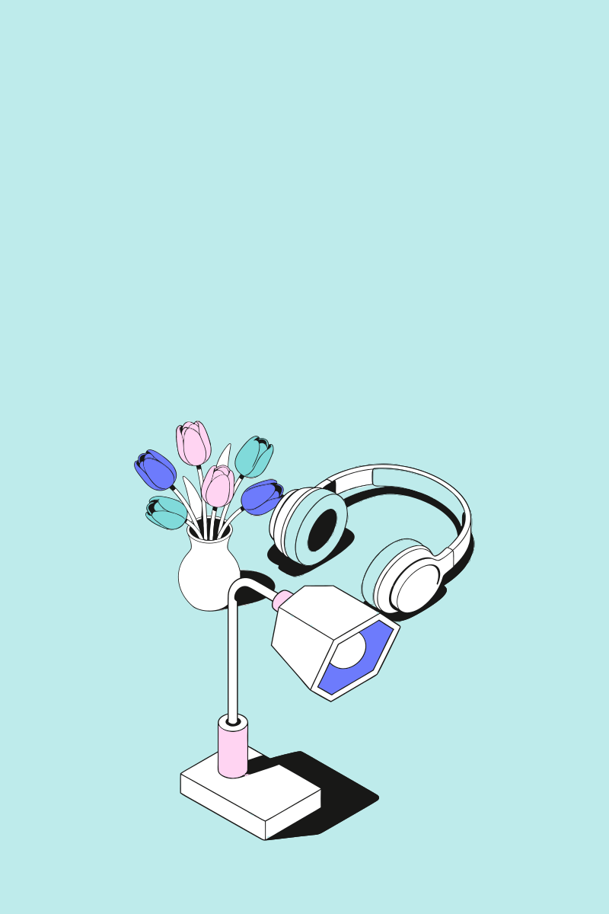

# Примеры композиций

Сгенерированы `npm run examples` тем же кодом, что и сервис.

## 01-finance-peach-1200x630.svg

- Сценарий А: «Как накопить на мечту: деньги, бюджет и идеи для экономии» (LLM nvidia/nemotron-3.5-super-vl:free)
- Объекты: coin, wallet, lamp, folder · фоновые: book · пресет assembled · 1200x630 · размер L · схема peach

## 02-study-lilac-1000x1000.svg

- Сценарий Б: «фоновые тюльпаны, книга, телефон, пазлы, наушники» (разбор названий)
- Объекты: book, phone, puzzle, headphones · фоновые: tulips · пресет offset · 1000x1000 · размер L · схема lilac

## 03-spring-teal-800x1200.svg

- Сценарий А: «Весенний вечер дома: цветы, музыка и открытка маме» (запасной режим: поиск по смысловым тегам)
- Объекты: tulips, headphones, pen · фоновые: lamp · пресет underTitle · 800x1200 · размер S · схема teal
